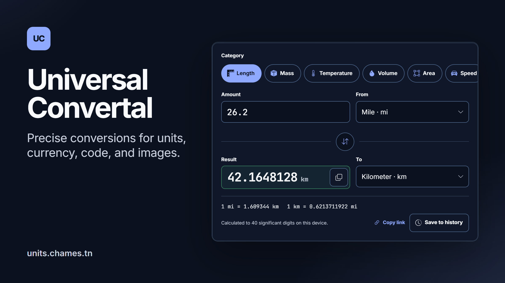

# Universal Convertal

[](https://units.chames.tn)

**Live:** [units.chames.tn](https://units.chames.tn)

Universal Convertal is a fast, honest conversion workspace for physical units, currency, developer transforms, and bounded image conversion. Ordinary unit and developer calculations run through the shared TypeScript domain package so the browser can respond without a network round trip. The API provides provider-backed currency data, parity endpoints, and small synchronous Sharp image conversions.

## Workspace

```text
apps/
  web/                 Next.js application
  api/                 Fastify API
packages/
  conversion/          @simple-units/conversion domain package
  contracts/           API schemas and OpenAPI artifacts
```

The workspace uses pnpm 11.25.0, Turborepo 2.11.7, and Node.js 24 LTS. pnpm is the only committed package manager and `pnpm-lock.yaml` is the only dependency lockfile.

## Development

Install the pinned toolchain, then install all workspace dependencies:

```sh
pnpm install --frozen-lockfile
pnpm dev
```

Run focused checks or the complete graph:

```sh
pnpm lint
pnpm typecheck
pnpm test
pnpm build
```

Use `pnpm --filter ./apps/web dev` or `pnpm --filter ./apps/api dev` when working on one application. The root scripts delegate to Turborepo; package task logic belongs in the package that owns it.

On Windows, the root `pnpm dev` command runs the same Turbo graph through a
small Node supervisor with piped stream logs. This avoids the interactive
Turbo console crash seen with some pnpm/Windows terminals while keeping the
package dependencies and watchers unchanged. It prints the API endpoint it
selected. With no explicit `HOST` or `PORT`, an occupied `127.0.0.1:8787`
falls back to another loopback address or nearby port; explicit values fail
with an actionable collision message. The runner passes the selected URL to
the web rewrite. An exported `CONVERTAL_API_URL` takes precedence during the
root dev run; `apps/web/.env.local` remains the configuration source for
focused web development and production builds.

## Local UI audit

Run the API and web development servers in separate PowerShell terminals, then
run the UI audit in a third terminal. These commands use loopback addresses and
an explicit web port so the audit does not depend on an unrelated server using
the default port:

```powershell
# Terminal 1: API
$env:HOST = '127.0.0.2'
$env:PORT = '8787'
pnpm --filter @universal-convertal/api dev

# Terminal 2: web
$env:CONVERTAL_API_URL = 'http://127.0.0.2:8787'
pnpm --filter @universal-convertal/web exec next dev --hostname 127.0.0.1 --port 3100

# Terminal 3: five-route responsive, keyboard, behavior, and axe audit
$env:BASE_URL = 'http://127.0.0.1:3100'
pnpm --filter @universal-convertal/web qa:ui
```

The UI audit writes `results.json`, `README.md`, and screenshots under
`qa-results/ui/` by default (ignored by git). Set `QA_ARTIFACT_DIR` to choose another
output directory, and `CHROME_PATH` when Chrome is installed somewhere other
than the runner's default path. Run `pnpm --filter @universal-convertal/web
qa:performance` only after a production build is running; set `BASE_URL` to
that preview's origin. The performance script records local lab measurements
and does not start or build the server.

Unit history is saved only through **Save to history**. Browsing categories,
editing values or units, swapping, restoring entries, and copying never save
automatically. Existing history remains available; **Clear all** and **Undo**
operate on the active tool.

Run `pnpm --filter @universal-convertal/web qa:history` against a running
production build to check this behavior. Set `BASE_URL` to its origin
(default `http://127.0.0.1:3220`). The test blocks API requests and writes
results and screenshots under `qa-results/history/` by default.

## Cover and link-preview images

`docs/portfolio/cover-{dark,light}.png` (16:9) and the link-preview image
`apps/web/app/opengraph-image.png` (1200×630) are captured from the real unit
converter. After a UI change, start a production build and regenerate them,
then rebuild so Next.js serves the new preview:

```powershell
$env:BASE_URL = 'http://127.0.0.1:3230'
pnpm --filter @universal-convertal/web cover
```

## Capability boundaries

- Unit arithmetic uses typed dimensions, decimal factors, affine temperatures, and explicit error codes in `@simple-units/conversion`.
- Currency rates come from a server-side adapter. Responses include provider and freshness metadata; stale or unavailable rates are visible in the UI.
- Developer transforms run locally with bounded inputs and allowlisted semantics.
- Image conversion accepts only bounded uploads and allowlisted raster operations in the API. Larger document/media/archive jobs require a later isolated worker design.

See [system design.md](system%20design.md) for the product and visual system.

The local UI primitives and their licenses are listed in
[THIRD_PARTY_NOTICES.md](THIRD_PARTY_NOTICES.md). Product-specific route and
workbench composition lives beside the app; no complete SaaS template was
copied into the workspace.

## Deployment

Production uses Docker Compose with the existing Traefik instance. For the
first VPS setup, update commands, health checks, routing, and runtime settings,
see [docs/deployment.md](docs/deployment.md). The API stays private on the
Compose backend network; the public /api/ route is rate-limited by Traefik and
forwarded through the web service.

The app lives at [units.chames.tn](https://units.chames.tn). The older Vercel
projects for this repository only redirect there; `vercel.json` holds that
redirect and skips the install and build on Vercel.

